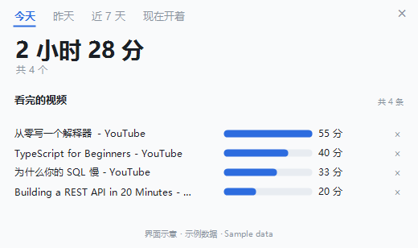
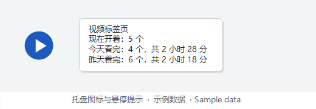
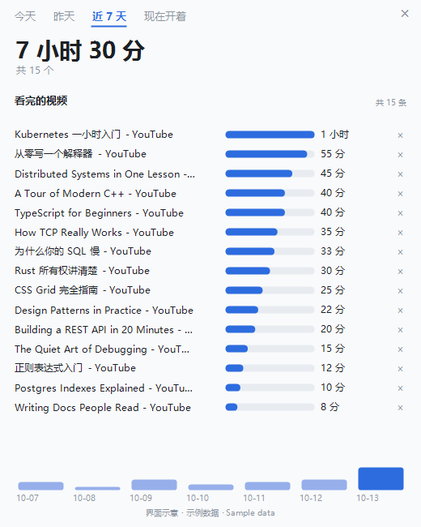
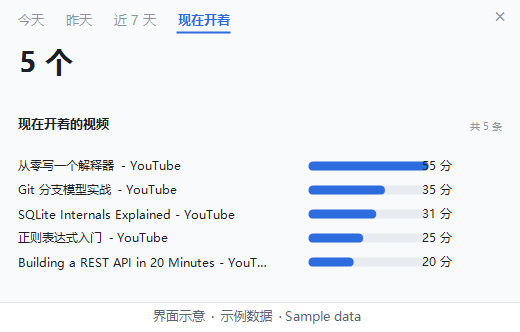

# 视频标签页计数器

**简体中文** ｜ [English](README.md)

跑步机的魅力在于它记录数据——没有数字反馈的事，很难坚持。

Chrome 会告诉你现在开着几个标签页，但不会告诉你**昨天看了多少个视频、一共看了多久**。
这个小工具把这件事变成 Windows 托盘上的一个数字。



**界面示意：图里是示例数据，不是任何人的使用记录。**

**给谁用**：平时在 Chrome 里看教程和技术视频，想知道自己一天到底花了多久、看了几个的人。

**为什么值得挂在托盘上**

- **纯本地**：看了哪些、看了多久都只记在这台机器上；只有查视频时长那一步会联网。
- **不要管理员、不装运行库、不改执行策略**：双击启动器就能跑。
- **一个数字就够**：托盘图标上是现在开着的视频标签数，鼠标一停就能看到今天和昨天看了多少、一共多久。
- 每 5 秒看一次标签栏，占内存 100–150 MB。

版本 1.2 ｜ MIT 许可（见 [LICENSE](LICENSE)）｜ 个人自用工具，不保证适配你的环境

---

## 它长什么样

- **图标**：蓝色圆圈，里面是现在开着的视频标签页数量。三位数以内直接显示，超过显示 999。
  
- **鼠标悬停**会弹出四行：第一行是标题，第二行是现在开着的数量，
  第三行是今天看完的数量和这些视频的合计时长，第四行是昨天的同样内容。
  某一天没有可统计的时长时，那一行就只显示数量。
  

- **右键菜单**：

| 菜单项 | 作用 |
| --- | --- |
| 明细 | 从右下角弹出一张面板，点别的地方自动收起 |
| 立即刷新 | 马上再读一次（不弹窗） |
| 打开计数文件夹 | 打开本工具所在的文件夹 |
| 退出 | 结束程序 |

托盘图标左键单击是开关：点一下打开明细，再点一下收起来；也可以点面板外面，或者点右上角的叉。右键菜单里是同一套功能。

### 明细面板

打开就是一张图，不用读文字：

- 左上角三个标签切换**今天 / 昨天 / 近 7 天**，默认是今天。
- 中间一行大字是这段时间看完的视频总时长，下面小字写共几个、有几个时长未知、现在开着几个。
- 然后是**看的视频**清单：每条一行，标题后面一条横条按时长比例画，右边是这条的时长。
  清单装不下时右边会出现一条滚动条，滚轮和拖滚动条都能往下翻。
- 每行最右边有一个**「×」**。误记的那条（点开一下就被算成一次看完的）点它一下就从记录里抹掉，
  上面的大字和条数当场跟着减，不用重启。它只在「今天 / 昨天 / 近 7 天」这三栏有；
  「现在开着」是此刻标签栏的实况、不是记录，那栏没有它。
- 最下面是**近 7 天**每天一根竖条，条高是那天的合计时长，今天那根是深色的。这排柱子只在「近 7 天」这一栏才有；鼠标停在某一根上，它会高亮并显示那天的日期和时长。





## 装之前需要什么

- Windows 10 或 11（自带 PowerShell 5.1 和 .NET Framework，所以不用装运行库）
- 装了 Chrome，并且平时用 Chrome 看视频
- 不需要管理员权限，不需要改 PowerShell 执行策略
- 数量和时间全部本地完成；只有「视频时长」那一项要联网

## 怎么装

1. **先解压、再解锁**，这一步别跳。
   - 不要在压缩包窗口里直接双击运行，那样会解到临时目录，路径全乱。先把整个文件夹解压到硬盘上。
   - 从网上下载来的文件，Windows 会标记来源，不解锁的话双击会弹「Windows 已保护你的电脑」。
     做法：进到文件夹，全选所有文件 → 右键 → 属性 → 底下如果有「解除锁定」，勾上、确定。
     所有文件都做一遍，不用管哪个是 `.vbs` 哪个是 `.ps1`。
   - 如果没有「解除锁定」这一项却仍然被拦：弹窗里点「更多信息」，再点「仍要运行」。
   - Win11 默认不显示扩展名，文件夹里看到的是 `start-counter` 而不是 `start-counter.vbs`。
     想看清扩展名：资源管理器 → 查看 → 显示 → 文件扩展名。

2. 把整个 `video-tab-counter` 文件夹放到一个固定位置，比如 `D:\tools\video-tab-counter`。
   路径不敏感，中文和空格都行。**但必须是能写的目录**——别放在「Program Files」这类要管理员权限的
   地方，它要在自己这个文件夹里写记录和日志。

   位置尽量定下来。挪动之后程序本身还能跑，但第 5 步的自启快捷方式会失效
   （症状是下次开机图标不出现），把启动文件夹里那个快捷方式删掉重建即可。

3. 双击启动器（`start-counter`）。托盘出现图标就算装好，首次启动等一两秒。

4. 图标没出现或者找不到：
   - 先点任务栏右下角那个向上的小箭头（∧），那是「隐藏的图标」面板，多半在里面。
   - 想让它常驻：设置 → 个性化 → 任务栏 → 其他系统托盘图标，把开关打开。
   - **注意**：Windows 是按程序来记托盘项的，这两个工具都是 PowerShell 跑的，
     所以在那个列表里它显示成「Windows PowerShell」，不叫「视频标签页计数器」。
     认它要靠外观：蓝色圆圈里面是数字。

5. 开机自动跑，两种办法任选一种：

   **办法 A**：右键启动器 → 发送到 → 桌面快捷方式；按 `Win + R` 输入 `shell:startup` 回车，
   打开「启动」文件夹；把桌面那个快捷方式剪贴进去。

   **办法 B**：在「启动」文件夹里右键 → 新建 → 快捷方式，位置填下面这行
   （路径换成你实际的，引号要留着，路径有空格时尤其需要）：

   ```
   wscript.exe "D:\tools\video-tab-counter\start-counter.vbs"
   ```

### 桌面图标

桌面快捷方式默认显示的是 Windows 脚本的图标，三个工具长得一样，认不出来。
想让它们跟托盘那个圆点一致：右键快捷方式 → 属性 → 更改图标 → 选本文件夹里的 `icon.ico`。

## 怎么用

- 平时不用管，它每 5 秒看一次 Chrome 的标签栏。
- 想看细节就右键图标点「明细」。
- 同一时间只会跑一个：重复双击，多出来的那个会自己退出。
- 占内存大约 100 到 150 兆。

## 实现细节

- **实时数据来自 UI Automation**，直接读 Chrome 的标签栏，不去碰 Chrome 的会话文件（那份在运行期间读不到，能读到的那份是启动时的快照）。
  实测读一次完整标签栏 46–64 毫秒，所以轮询间隔定在 5 秒。
- **视频时长走 YouTube 官方 Data API v3** 的 `videos.list`：一次请求最多带 50 个视频 ID，
  第一个请求约 2–3 秒（建立连接），之后每个请求一百多毫秒、返回 8 KB 左右。取过的时长永久缓存，不再联网。
- **状态文件先写临时文件再替换**；读不出来时把残骸留下、写出日志，并从上一版备份恢复，不会当成第一次运行。
- 托盘图标和明细面板都是运行时自绘的，不带图片资源；常驻内存约 100–150 MB。

## 什么算「看完」（这个数怎么来的）

- 一个视频算「看完」，是指它曾经出现在标签栏里、后来又不在里面了：
  要么你把标签关掉了，要么播放列表往后走到了下一个。
- 但它得**被看到至少 15 秒**才算一次。点开一个、发现点错了、马上叉掉，这种不记。
- 它每 5 秒扫一次标签栏，所以「看到多久」是按这个粒度量的：15 秒相当于至少跨过三次扫描。
- 归到哪一天，看的是它**离开标签页的那一刻**，不是打开的时刻。
- 同一个视频看两遍只算一个，判定依据是标题：「今天」里重复看不重复计，「近 7 天」里跨天重复看
  也不重复计，时长同样只算一次。YouTube 中途改过标题的话会被当成两个，这是已知的粗糙之处。
- 「现在开着」是当前还开着的视频标签页数量。
- 「今天」按你本机的零点切换。
- 合计时长的算法就一句：那天看完的这些视频，各自有多长，加起来。
  它记的是视频本身的长度，跟你在页面上停留了多久没有关系，也拿不到那个数据。
- 注意别把两个数看混：「现在开着」是当前标签页的个数，「今天看完」「昨天看完」
  才是离开标签页的那些，合计时长只累加后两者。本地会提前把见过的视频时长存下来当缓存，
  但那只是缓存，不进合计。
- 支持统计时长的目前只有 YouTube。B 站等站点的视频会算进数量，但拿不到时长，
  明细里标成「时长未知」，不计进合计；等时长取回来会自动补上。

## 第一次装完会看到什么

今天和昨天都从零开始数，刚装上时两个数都是 0。「昨天看完」要等第二天才会有数。这不是坏了。

没配密钥时，提示里没有「共 X 小时 Y 分」那半句，只有数量。

## 重置

右键退出，删掉 `state.json`，再重新启动，计数就从头开始。
时长缓存 `durations.json` 可以留着，不用重取。

## 想要时长统计（可选，需要联网）

不配也能用，只是没有时长和合计。断网也只是合计里少几个，数量照常统计。

1. 打开 Google Cloud 控制台，新建一个项目
2. 左边「API 和服务」→「库」，搜 YouTube Data API v3，点「启用」
3. 「API 和服务」→「凭据」→「创建凭据」→「API 密钥」
4. 建议给密钥加限制：选「限制密钥」，只勾 YouTube Data API v3，保存
5. 存成密钥文件，这一步最容易翻车：
   - 记事本打开，粘贴那串以 `AIza` 开头的字符串，不要引号、不要多空行
   - 另存为时「保存类型」一定选「所有文件」，文件名填 `yt-api-key.txt`。
     如果保存类型是「文本文档」，Windows 会自动补成 `yt-api-key.txt.txt`，程序就找不到
   - 文件放在 `video-tab-counter` 文件夹里，和 `counter.ps1` 并排

怎么确认生效：等五到十分钟，右键「明细」看时长出来没有。

这个工具只把视频 ID 和你的密钥发给 YouTube，不发任何本地信息。
一次能问 50 个视频，这个额度对个人使用来说用不完。

## 常见故障对照

**图标不见了**
先点任务栏的 ∧ 看隐藏面板；再检查 设置 → 个性化 → 任务栏 → 其他系统托盘图标
（里面显示成 Windows PowerShell）。

**数字一直不动**
Chrome 没开的时候本来就定格，重新打开 Chrome 会继续。
Chrome 开着还不动：右键「立即刷新」；再不行看下面的日志。

**开机后图标不出现，以前是好的**
多半是挪过文件夹，自启快捷方式失效了，删掉重建。

**双击启动器没反应**
先按第 1 步做解除锁定；再看杀毒软件是不是拦了 `.vbs`。
手动跑一次：开始菜单搜 PowerShell 打开，粘贴下面这行回车，看有没有红字
（执行策略要显式带上，直接右键「使用 PowerShell 运行」会因为策略被拦）：

```
powershell -NoProfile -ExecutionPolicy Bypass -File "D:\tools\video-tab-counter\counter.ps1" -Once
```

**所有视频都显示「时长未知」**
先看 `yt-api-key.txt` 是不是变成了 `yt-api-key.txt.txt`；再确认文件里只有那一串字符；
最后看 `duration-fetch.log`。

**数字明显不对**
删掉 `state.json` 重新开始记。

## 日志怎么看

`counter.log`、`duration-fetch.log` 都在工具文件夹里，双击就用记事本打开了。
它们很小（几十 KB 以内），删了会自动重建。

正常运行时 `counter.log` 基本是空的或者只有几行；如果里面有 `skipped a round` 这类字样，
说明某几次没读到 Chrome 标签栏，那几次的变化会漏记，把日志留着我来看。
日志是空的又确实有问题，就走上面的常见故障对照。

## 怎么删干净

1. 右键托盘图标 → 退出。
   这一步别省。实测不退也能把文件夹删掉，但那个进程还在后台跑，
   而且每隔几秒就找不到文件报一次错，你还得再去任务管理器结束它。先退出省事。
2. 确认真的退干净：按 `Ctrl+Shift+Esc` 打开任务管理器，切到「详细信息」标签，
   右键列标题 → 选择列 → 勾上「命令行」，找 `powershell.exe`，
   看命令行里还有没有 `counter.ps1`。没有就算干净。
   如果文件夹已经删了但进程还在：在任务管理器里结束那个 `powershell.exe`，或者重启一次电脑。
3. 删掉整个 `video-tab-counter` 文件夹。观看记录和时长缓存也在里面，一起没了。
4. 删掉「启动」文件夹里那个快捷方式（如果你设过自启）。`Win + R` 输入 `shell:startup` 回车就能打开。
5. 如果你在「其他系统托盘图标」里动过开关，那里会留一条记录（记的是 PowerShell 这个程序，
   不是本工具），不用特意清，不影响什么。
6. 如果你配过 YouTube 密钥，建议顺手去 Google Cloud 把那个密钥删掉或停用，
   卸载本工具不会动到它。

除此之外没改过系统别的东西：没有系统服务，没有安装程序，注册表里也只有上面第 5 条那个托盘开关记录。

## 怎么更新

这个文件夹就是全部，没有自动更新。你自己留着新版本的话：
先右键托盘图标退出，用新版本覆盖整个文件夹，再双击启动器。
`state.json` 和 `durations.json` 留着，历史和时长缓存都不会丢。

版本号在 README 第一行标题下面，也在 `counter.ps1` 开头的注释里
（看注释要用记事本打开，直接双击 `.ps1` 会运行它）。

## 已知的小毛病

- 只统计一个 Chrome 窗口。同时开多个 Chrome 窗口时，只有主窗口里的标签会被数到。
- 标签页多到标签栏要滚动时，「现在开着」会少算十来个：系统只把已经排出来的标签暴露给程序（实测 175 个只数到 162 个）。要数准得给 Chrome 加启动参数，那样就不是双击即用了，所以保持现状。
- Chrome 启动之后新打开的纯列表页或频道页，可能被当成一个视频标签，
  「现在开着」会多算一个；这种标签被关掉时「今天看完」也会多记一个。
- 同一个视频如果标题被 YouTube 改过，会被当成两个。
- 关掉整个 Chrome（不是关标签，是退出浏览器）不会把开着的标签算成「看完」，
  程序对这种情况有保护，会保持原状等 Chrome 回来。


## 同一套的另外两个工具

- [屏幕点亮时长](https://github.com/NutshellLee/screen-time-counter)——托盘上看今天屏幕亮了多久
- [大模型 token 用量计数器](https://github.com/NutshellLee/dsh-token-counter)——托盘上看本机 DSH 今天用了多少 token

## 版本历史

- **1.2**（2026-10-13）明细面板每一行右边加了「×」：误记的那条点一下就抹掉，合计和条数当场跟着减；「看完」的门槛从 10 秒提到 15 秒。
- **1.1**（2026-10-12）左键改成开关：点一下开、再点一下关；修了标题清洗——Chrome 塞进标签名的「正在出声 / 吃内存高」现在会被反复剥干净，启动时把历史里 10 个脏键洗回干净名字。
- **1.0**（2026-10-12）第一次发布：托盘图标显示现在开着的视频标签数；明细面板按今天 / 昨天 / 近 7 天列出看完的视频和时长；右键菜单里有刷新、打开文件夹、退出。

## 文件都是干什么的

| 文件 | 说明 |
| --- | --- |
| `counter.ps1` | 主程序 |
| `start-counter.vbs` | 启动器，双击这个 |
| `fetch-durations.ps1` | 取时长的帮手，程序自己按需拉起 |
| `README.md` / `README.zh-CN.md` | 英文版和中文版；你正在看的是中文版 |
| `AGENTS.md` | 给改代码的 AI 看的，普通使用可以不管 |
| `NOTES.md` | 做法和踩过的坑，想了解原理可以看 |
| `LICENSE` | 许可 |
| `state.json` / `durations.json` / `*.log` | 运行后自动生成，可以随手删 |

想改代码，看 [AGENTS.md](AGENTS.md)；想知道这些数**是怎么**从 Chrome 里抠出来的、
以及中间踩了哪些坑，看 [NOTES.md](NOTES.md)。
